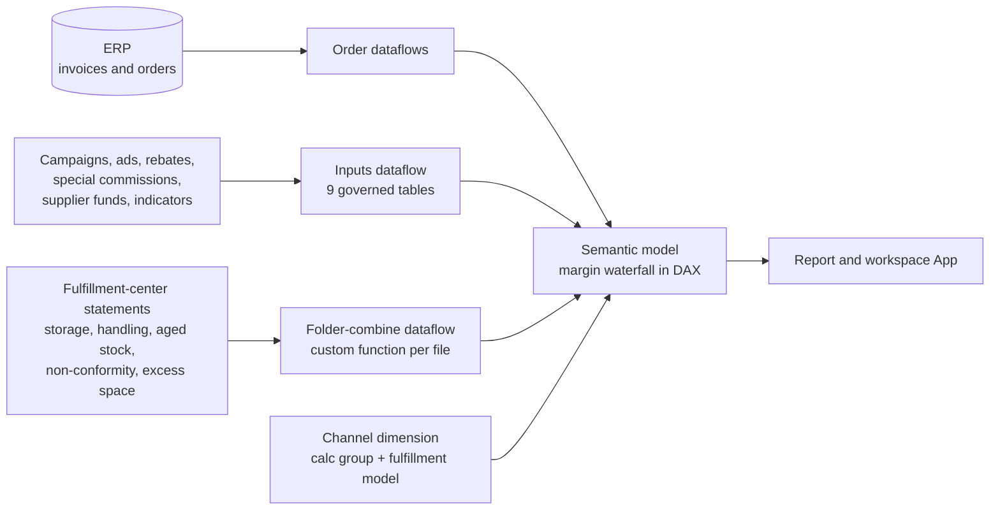

# Commercial Margin Model

🇧🇷 [Leia em português](README.pt-BR.md)

A governed semantic model that answers one question for every order: **how much did we actually make, and why?** Margin is built as a transparent waterfall of ~35 signed components (marketplace fees, freight, promotions, taxes, product cost, ads, fulfillment, returns, support, losses) instead of a single opaque percentage.

> Power BI / Fabric semantic model, DAX, Power Query (M), dataflows and an ERP data dictionary.
> Everything here is **sanitized or synthetic**. No real company, partner, price, cost or margin appears in this repository.

## The problem

Commercial decisions (pricing, campaigns, ads, which channel to push) were made on a margin number nobody could decompose. Costs lived in different places: marketplace statements, ERP, fulfillment-center invoices, campaign sheets, supplier-fund agreements. Rules also change over time (a seller reputation indicator changes freight subsidy month by month), so last quarter's order cannot be judged with this quarter's rule.

## The solution



- **A written margin definition** – each component documented with sign, meaning and source: platform-related items (commission, channel freight, fixed fee, installment fee, discounts and coupons, rebates) and operation-related items (product cost, taxes, supplier and e-commerce funds, ads by campaign and by SKU, fulfillment, reverse logistics, RMA, support, cancellations, chargebacks, losses, cost of capital, obsolescence).
- **Data dictionary of the model** – 150+ documented fields: table, alias, behavior (column / calculation), calculation rule and business description, so a new analyst can audit any number.
- **Channel dimension** – each channel maps to a *calculation group* and a *fulfillment model* (self-fulfilled vs. marketplace-fulfilled), so one set of measures serves every channel.
- **Time-variant rules** – seller indicators are stored with validity windows (month by month) and looked up by the invoice date of each order.
- **Governed inputs** – nine input tables (campaigns, ads, special commissions, freight indicators, SKU monitor, supplier funds, rebates, marketing funds) are maintained in controlled files and loaded through a single dataflow, so business owners update data without touching the model.
- **Messy-file ingestion** – fulfillment-center statements arrive as many monthly files in different layouts; a custom function per layout combines them into one cost table by SKU and period.
- **Display-folder framework** – measures and columns of the large fact table are organized by domain, so the model stays navigable as it grows.

## Run the reference implementation

[`reference_implementation/margin_waterfall.py`](reference_implementation/margin_waterfall.py) reproduces the waterfall and the time-variant freight indicator with synthetic parameters, so the logic can be read and tested without Power BI.

```bash
pip install pytest && pytest -q
```

## Design decisions worth noting

- **Explainability over a single number** – every component is separate and signed, and the tests assert that the parts add up to the margin.
- **Rules have validity dates** – no retroactive re-pricing of history.
- **One model, many channels** – behavior comes from dimension attributes, not from per-channel copies of measures.
- **Documentation is part of the model** – the data dictionary and metric definition ship with it.

<!-- RESULTS: add measurable outcomes later (decisions enabled, margin leakage found, model refresh time, users). -->

## About

Built and maintained by [Bárbara Gomes](https://github.com/Barbarags) – Data & BI Coordinator.
